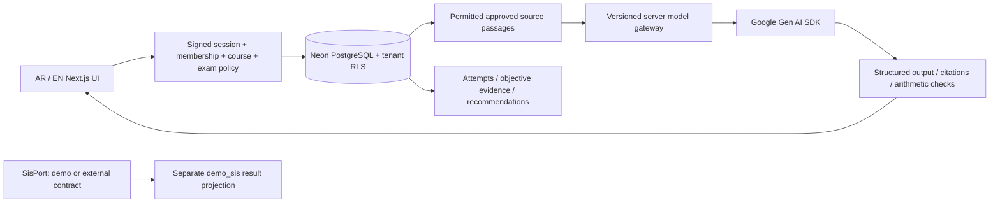

# Tilwa | تِلوا

**Know your path · اعرف طريقك**

تجربة تعليمية جامعية كاملة الطبقات بـNext.js وTypeScript، مع PostgreSQL، مصادر خاصة، وصلاحيات فعلية للطالب والمدرّس والمرشد. Gemini يعمل من السيرفر بعد التحقق من الصلاحيات واسترجاع الدليل المعتمد. بيانات الأشخاص والمؤسسة والسجل السابق اصطناعية ومعلّمة داخل التطبيق.

A bilingual university pilot with authenticated, tenant-scoped learning, private source ingestion/review, objective-level formative evidence, advising and replaceable SIS integration. The original logo, Arabic fonts and dashboard illustration/styles come from the supplied design references.

**Current verification — 13 November 2026:** **110/110 unit/integration tests**, TypeScript, production build and **7/7 production browser journeys** passed locally. Real Neon migrations, seed, tenant isolation and all six authentic lecture imports passed. A real guarded `gemini-3.5-flash-lite` tutor answered the L4 Recall question with valid source locators; a real graph and bilingual teaching session/question were generated, reviewed through the instructor UI and published. Seven additional source/browser checks and five instructor approval/publication checks passed against Neon. The final deployed browser also passed the exact Arabic question, source opening, mobile persistence, RTL/LTR and advisor view. See [measured verification](docs/verification.md).

**Vercel Preview:** [Open Tilwa](https://tilwa-6twb3yvyj-mohamedtarek750s-projects.vercel.app) — **live acceptance passed** against real Neon and Gemini in Arabic, English and mixed language. Vercel retains its existing login protection. Fresh practice, sign-out persistence, protected exams and assigned-advisor isolation passed on this deployment.

## Run locally / التشغيل المحلي

Node.js 22+ (validated on Node 24), npm, Chromium for browser tests.

```bash
npm ci
npm run dev:local
```

`dev:local` explicitly uses disk-persistent PostgreSQL/PGlite, applies migrations, seeds synthetic demo records and starts Next. It creates a private session-signing secret under ignored `.tilwa-private/`. It never silently substitutes local storage for Neon; local mode is refused on Vercel. Gemini remains unavailable without a real key: no mock model is used by application routes.

Open the running application using your development environment's browser. The onboarding UI has no supported public localhost Preview link.

### أسرع تجربة للأدوار

1. افتح رابط Preview بعد تسجيل الدخول إلى Vercel، ثم أدخل رمز مساحة الديمو المحفوظ محليًا في `.tilwa-private/demo-workspace-code` دون مشاركته علنًا. اختر **مدرّس**: المحاضرات الست والملحق مستوردة بالفعل. افتح مراجعة المصادر والمقترحات، راجع الخريطة والجلسة والسؤال العربي/الإنجليزي، ثم اعتمد المحتوى وانشره. الخريطة والجلسة والسؤال الجديد المعدّل بنتيجة **70%** تمت مراجعتها واعتمادها ونشرها من الواجهة. يمكنك توليد مقترح جديد ومراجعته بنفس المسار. في مساحة جديدة، ابدأ بـ**استيراد حزمة CET351** ورفع الملفات واحدة تلو الأخرى.
2. سجّل الخروج واختر **طالب** بنفس رمز المساحة. بعد نشر الجلسة، افتحها واسأل «ليه الـRecall هنا 60%؟». افتح مصدر L4 ص18–19، ثم حل سؤال التدريب الجديد. حسابات Preview تحفظ البيانات في Neon؛ التشغيل المحلي الصريح يستخدم PostgreSQL/PGlite.
3. من التفضيلات احتفظ برمز المساحة للعودة من متصفح آخر؛ هو رمز وصول لحسابات الديمو الثلاثة. سجل الخروج ثم ادخل بنفس الرمز للتحقق من التقدّم.
4. اختر **مرشد أكاديمي** لمراجعة دليل الطالب المعيّن والتوصية وRubric أعماله. حساب المدرّس يستطيع متابعة الجودة والتدخلات ومراجعة الإجابات المفتوحة.

Each fresh visitor receives a separate synthetic workspace. The role selector is gated by `DEMO_MODE=true` and disabled in Production. Signed HttpOnly cookies identify sessions; client role headers/query params confer no authority. The recovery code is a bearer credential for that synthetic workspace. Production SSO should replace demo entry with verified identity-to-membership mapping; retain server authorization and RLS.

## Neon, Gemini and Vercel / الإعداد والنشر

The database is designed from scratch in [migrations](migrations). **“Migrations” are the SQL commands that create Tilwa’s tables in an empty database. You do not need to supply an old database, migration files or student records.**

For the existing Neon database and the Vercel project `mohamedtarek750s-projects/tilwa`, use [deploy to existing resources](docs/existing-deployment.md). This path initializes the tables, creates the demo accounts and deploys a Preview in that project. It does not create another Neon or Vercel project and needs no Neon API key.

```bash
GEMINI_MODEL=gemini-3.5-flash-lite NEON_TRANSPORT=websocket DEPLOY_EXISTING=1 npm run deploy:existing
```

Supply the existing owner connection as `DATABASE_URL`, the Gemini key and authorized Vercel access through secure settings. The deployment command handles the schema and restricted application connection. Course PDFs are uploaded separately through the instructor interface or the private import command.

The alternative provisioner below is only for creating **new** provider resources. With authorized account credentials, the [provisioning runner](docs/preview-provisioning.md) creates isolated Neon and Vercel resources, applies the schema, creates a non-owner pooled runtime login and deploys only to Preview.

Set `NEON_API_KEY`, `VERCEL_TOKEN`, `GEMINI_API_KEY` securely; never put values in chat or Git. The pinned model is **`GEMINI_MODEL=gemini-3.5-flash-lite`**, verified through real guarded tutoring and generation in this project. `gemini-2.5-flash` returned 404 for this project; two bounded `gemini-3.8-flash` graph attempts timed out. Neither is claimed as a successful teaching model here. Preserve the existing server-only Gemini secret in Vercel Preview; cloud-proxy credential placeholders are not portable deployment keys.

```bash
PROVISION_PREVIEW=1 npm run provision:preview
```

With an existing non-production database, set server-only `DATABASE_URL` (pooled, non-owner), `MIGRATION_DATABASE_URL` (migration owner), `SESSION_SECRET` (32+ random characters), `GEMINI_API_KEY`, `GEMINI_MODEL`, `DEMO_MODE=true`, `LOCAL_DATABASE=0` in local/Preview settings. For private local `.env.local` files, load them explicitly:

```bash
NEON_TRANSPORT=websocket node --env-file=.env.local --import tsx scripts/migrate.ts
NEON_TRANSPORT=websocket node --env-file=.env.local --import tsx scripts/seed.ts
npm run build
npm run start
```

Use `NEON_TRANSPORT=websocket` for commands from this managed cloud environment; it uses the official Neon driver over verified WSS and retains real transactions/RLS. Vercel uses the default pooled PostgreSQL **TCP** transport. Existing `neon_auth` tables are preserved.

Next loads `.env.local` itself; CLI commands only read process environment unless `--env-file` is supplied. Seed is idempotent, preserving existing learner data. Schema migrations are tracked transactionally. The app fails closed when the database is unavailable.

## Sources / المصادر

[Source manifest](pilot/source-manifest.json) is authoritative for six PDF names, SHA-256 checksums and physical page counts. Original PDFs belong in private storage, never Git/public assets. Browser uploads are per-file and capped at 3.5 MB. The resumable CLI accepts a private directory or strictly bounded expected-file ZIP and imports files separately. See [source import](docs/source-import.md).

```bash
NEON_TRANSPORT=websocket LOCAL_DATABASE=0 npm run import:pack -- --tenant TENANT_UUID --user INSTRUCTOR_UUID --directory PRIVATE_DIR --register
# or --zip PRIVATE_ZIP instead of --directory
```

The GFG URL is registered as link/metadata only. It is **not** retrieved article evidence. Specifically authorized excerpts can be imported with locators/rights. The original bilingual `pilot/umbrella/tilwa-ml-foundations.md` is a separate source. L4 p.16 and L5 pp.18,21–23 are quarantined until corrected/reviewed. All six authentic PDFs now match their manifest hashes, sizes and page counts and have been imported into Neon: [integrity evidence](docs/evidence/authentic-sources.json). L4 pp.18–19 were visually inspected against the original PDF: TP=6, FN=4 and FP=20 give **60% Recall** and **≈23.1% Precision**. Those two pages and supplement U1–U5 received an agent review through the demo instructor account; this is **not institutional supervisor sign-off**.

Sources are hashed and versioned; duplicate uploads deduplicate, corrections create successor extracts and preserve historical citation IDs. Graph proposals remain pending until review/publication. Hard prerequisites reject cycles, self-loops, duplicate edges and phantom endpoints. Deterministic bilingual aliases retain concept identity. Publication and source access require course permissions.

## Modules and data contract



- Core SQL tables hold institutions/workspaces, users, memberships, course and advisor assignments, sessions, exam state, policies and audit records. A tenant-keyed typed JSONB record store holds domain objects/events with course/owner indexes. Source/version/chunk/blob/trace tables hold private material and model provenance. `demo_sis` owns integration inbox and official result projections.
- Independent calculate/choose/justify objectives; transparent first-unassisted-family baseline and tested BKT comparator. Completion, help/time and official grades remain separate.
- Deliberate-error critique stores wrong-step location and explanation; open responses need instructor moderation.
- Gradient transfer is explicitly supplemental; instructor interventions compare fresh independent item families descriptively, suppressing small groups.
- Career artifacts retain student inclusion choice and human rubric review; no employability/GPA prediction.
- Every external model call follows authorization and DB retrieval. Retrieval filters tenant/course/current version/rights/review before ranking; no web fallback, protected question keys, grade records, rosters or advisor notes in model payloads.
- SIS replacement, signed events, deduplication, revisions and revocations are documented in [SIS/provisioning](docs/preview-provisioning.md). Offline tests verify learner history and recommendations survive adapter replacement.

## Verification / الاختبارات

```bash
npm test                 # Local PostgreSQL + pure tests; model tests explicitly inject a deterministic gateway
npm run typecheck
npm run build
npm run dev:local       # Separate terminal for browser checks
npm run test:e2e         # Chromium; set CHROMIUM_PATH if needed
```

To repeat the actual non-production Preview acceptance:

```bash
LIVE_SMOKE=1 NEON_TRANSPORT=websocket LOCAL_DATABASE=0 \
  GEMINI_MODEL=gemini-3.5-flash-lite \
  LIVE_BASE_URL=https://tilwa-6twb3yvyj-mohamedtarek750s-projects.vercel.app \
  node --env-file=.env.preview.local --import tsx scripts/live-smoke.ts
```

Set `LIVE_WORKSPACE_CODE` securely for the reviewed workspace (private local code file above); do not print or commit it. Automated access to this protected Preview also needs its securely configured `VERCEL_AUTOMATION_BYPASS_SECRET`; normal browser visitors use the existing Vercel login. The live smoke makes three bounded real tutor requests (AR, EN, mixed), checks actual L4 locators/DB-first traces, verifies zero generation on out-of-scope refusal, persists an attempt across sign-out and opens assigned-advisor evidence. Missing prerequisites exit 2 and are reported as blocked. Actual reports and screenshot comparisons: [verification](docs/verification.md).

## Current limits

This is a pilot, not a deployed university service. Institutional history/QMS counts, supplementary reviewed items and SIS events are marked synthetic. Human academic review remains necessary: structured citations and arithmetic checks do not prove entailment. The lexical course-scope gate is a conservative baseline; broad multilingual adversarial coverage and formal learning-model validation require more evaluation. Production SSO, distributed ingestion workers, private object storage at scale and university SIS credentials are integration points. The verified real tutor result and authentic-source review cover the first L4 example. The core Preview journey passed with real providers; unreviewed lecture pages remain outside approved model evidence. The university SIS is represented by explicit local/external-contract fixtures, not a live university connection.
