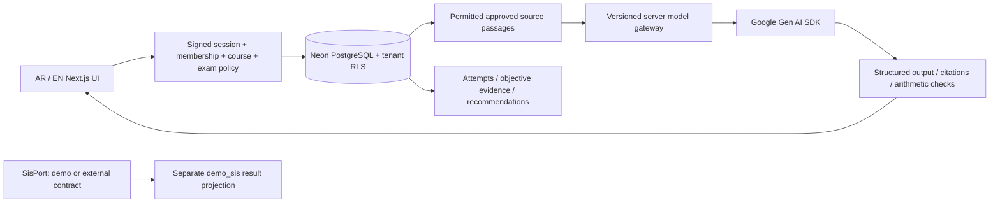

# Tilwa | تِلوا

**Know your path · اعرف طريقك**

تجربة تعليمية جامعية كاملة الطبقات بـNext.js وTypeScript، مع PostgreSQL، مصادر خاصة، وصلاحيات فعلية للطالب والمدرّس والمرشد. Gemini يعمل من السيرفر بعد التحقق من الصلاحيات واسترجاع الدليل المعتمد. بيانات الأشخاص والمؤسسة والسجل السابق اصطناعية ومعلّمة داخل التطبيق.

A bilingual university pilot with authenticated, tenant-scoped learning, private source ingestion/review, objective-level formative evidence, advising and replaceable SIS integration. The original logo, Arabic fonts and dashboard illustration/styles come from the supplied design references.

**Current verification:** local PostgreSQL tests and browser checks are recorded in [verification](docs/verification.md). Live Neon, real Gemini, authentic PDF ingestion and Vercel Preview remain blocked until provider credentials/network/source bytes are available. Local SQL tests and injected model replay are not live provider passes.

## Run locally / التشغيل المحلي

Node.js 22+ (validated on Node 24), npm, Chromium for browser tests.

```bash
npm ci
npm run dev:local
```

`dev:local` explicitly uses disk-persistent PostgreSQL/PGlite, applies migrations, seeds synthetic demo records and starts Next. It creates a private session-signing secret under ignored `.tilwa-private/`. It never silently substitutes local storage for Neon; local mode is refused on Vercel. Gemini remains unavailable without a real key: no mock model is used by application routes.

Open the running application using your development environment's browser. The onboarding UI has no supported public localhost Preview link.

### أسرع تجربة للأدوار

1. اختر **مدرّس** ← **استيراد حزمة CET351** لتسجيل المرجع الخارجي والملحق الأصلي. ارفع المحاضرات PDF واحدة تلو الأخرى. راجع النص والصفحة، واعتمد الصفحات السليمة. بعد إعداد Gemini، اقترح خريطة المفاهيم واعتمدها وانشرها؛ ثم ولّد جلسة وسؤالًا، راجعهما وانشرهما.
2. سجّل الخروج واختر **طالب** في نفس المتصفح. افتح الجلسة، اسأل بالعربية أو الإنجليزية أو بصيغة مختلطة. تظهر الإجابات المسندة مع روابط لعارض المصادر الخاص. التدريب والواجبات والخطة المهنية تعمل محليًا، وتُحفظ في قاعدة البيانات.
3. من التفضيلات احتفظ برمز المساحة للعودة من متصفح آخر؛ هو رمز وصول لحسابات الديمو الثلاثة. سجل الخروج ثم ادخل بنفس الرمز للتحقق من التقدّم.
4. اختر **مرشد أكاديمي** لمراجعة دليل الطالب المعيّن والتوصية وRubric أعماله. حساب المدرّس يستطيع متابعة الجودة والتدخلات ومراجعة الإجابات المفتوحة.

Each fresh visitor receives a separate synthetic workspace. The role selector is gated by `DEMO_MODE=true` and disabled in Production. Signed HttpOnly cookies identify sessions; client role headers/query params confer no authority. The recovery code is a bearer credential for that synthetic workspace. Production SSO should replace demo entry with verified identity-to-membership mapping; retain server authorization and RLS.

## Neon, Gemini and Vercel / الإعداد والنشر

The database is designed from scratch in [migrations](migrations). There is no requirement to supply an existing application schema. With authorized account credentials, the [provisioning runner](docs/preview-provisioning.md) creates isolated Neon and Vercel resources, applies the schema, creates a non-owner pooled runtime login and deploys only to Preview.

Set `NEON_API_KEY`, `VERCEL_TOKEN`, `GEMINI_API_KEY` securely; never put values in chat or Git. The candidate `GEMINI_MODEL=gemini-2.5-flash` is **not yet verified against a Google project**. Provisioning verifies its actual model ID before deploying. If a cloud proxy supplies credential placeholders, use portable raw secret bindings for deployment or set the Gemini secret directly in Vercel Preview.

```bash
PROVISION_PREVIEW=1 npm run provision:preview
```

With an existing non-production database, set server-only `DATABASE_URL` (pooled, non-owner), `MIGRATION_DATABASE_URL` (migration owner), `SESSION_SECRET` (32+ random characters), `GEMINI_API_KEY`, `GEMINI_MODEL`, `DEMO_MODE=true`, `LOCAL_DATABASE=0` in local/Preview settings. For private local `.env.local` files, load them explicitly:

```bash
node --env-file=.env.local --import tsx scripts/migrate.ts
node --env-file=.env.local --import tsx scripts/seed.ts
npm run build
npm run start
```

Next loads `.env.local` itself; CLI commands only read process environment unless `--env-file` is supplied. Seed is idempotent, preserving existing learner data. Schema migrations are tracked transactionally. The app fails closed when the database is unavailable.

## Sources / المصادر

[Source manifest](pilot/source-manifest.json) is authoritative for six PDF names, SHA-256 checksums and physical page counts. Original PDFs belong in private storage, never Git/public assets. Browser uploads are per-file and capped at 3.5 MB. The resumable CLI accepts a private directory or strictly bounded expected-file ZIP and imports files separately. See [source import](docs/source-import.md).

```bash
npm run import:pack -- --tenant TENANT_UUID --user INSTRUCTOR_UUID --directory PRIVATE_DIR --register
# or --zip PRIVATE_ZIP instead of --directory
```

The GFG URL is registered as link/metadata only. It is **not** retrieved article evidence. Specifically authorized excerpts can be imported with locators/rights. The original bilingual `pilot/umbrella/tilwa-ml-foundations.md` is a separate source. L4 p.16 and L5 pp.18,21–23 are quarantined until corrected/reviewed. L4 pp.18–19 have **not** been checked against original bytes in this environment; no real 60% lecture-grounding pass is claimed.

Sources are hashed and versioned; duplicate uploads deduplicate, corrections create successor extracts and preserve historical citation IDs. Graph proposals remain pending until review/publication. Hard prerequisites reject cycles, self-loops, duplicate edges and phantom endpoints. Deterministic bilingual aliases retain concept identity. Publication and source access require course permissions.

## Modules and data contract



- Core SQL tables hold institutions/workspaces, users, memberships, course and advisor assignments, sessions, exam state, policies and audit records. A tenant-keyed typed JSONB record store holds domain objects/events with course/owner indexes. Source/version/chunk/blob/trace tables hold private material and model provenance. `demo_sis` owns integration inbox and official result projections.
- Independent calculate/choose/justify objectives; transparent first-unassisted-family baseline and tested BKT comparator. Completion, help/time and official grades remain separate.
- Deliberate-error critique stores wrong-step location and explanation; open responses need instructor moderation.
- Gradient transfer is explicitly supplemental; instructor interventions compare fresh independent item families descriptively, suppressing small groups.
- Career artifacts retain student inclusion choice and human rubric review; no employability/GPA prediction.
- Every external model call follows authorization and DB retrieval. Retrieval filters tenant/course/current version/rights/review before ranking; no web fallback, protected question keys, grade records, rosters or advisor notes in model payloads.
- SIS replacement, signed events, deduplication, revisions and revocations are documented in [SIS/provisioning](docs/preview-provisioning.md). Offline tests verify learner history and recommendations survive adapter replacement.

## Verification / الاختبارات

```bash
npm test                 # Local PostgreSQL + pure tests; model tests explicitly inject a deterministic gateway
npm run typecheck
npm run build
npm run dev:local       # Separate terminal for browser checks
npm run test:e2e         # Chromium; set CHROMIUM_PATH if needed
```

After real lecture ingestion/review on an actual non-production Neon/Gemini deployment:

```bash
LIVE_SMOKE=1 LIVE_BASE_URL=https://YOUR-PREVIEW.vercel.app \
  node --env-file=.env.preview.local --import tsx scripts/live-smoke.ts
```

Set `LIVE_WORKSPACE_CODE` securely for the reviewed workspace. The live smoke makes three bounded real tutor requests (AR, EN, mixed), checks actual L4 locators/DB-first traces, verifies zero generation on out-of-scope refusal, persists an attempt across sign-out and opens assigned-advisor evidence. Missing prerequisites exit 2 and are reported as blocked. Actual reports and screenshot comparisons: [verification](docs/verification.md).

## Current limits

This is a pilot, not a deployed university service. Institutional history/QMS counts, supplementary reviewed items and SIS events are marked synthetic. Human academic review remains necessary: structured citations and arithmetic checks do not prove entailment. The lexical course-scope gate is a conservative baseline; broad multilingual adversarial coverage and formal learning-model validation require more evaluation. Production SSO, distributed ingestion workers, private object storage at scale and university SIS credentials are integration points. Model availability, authentic lecture accuracy and production platform behavior must be verified with real resources before claiming the complete live acceptance journey.
